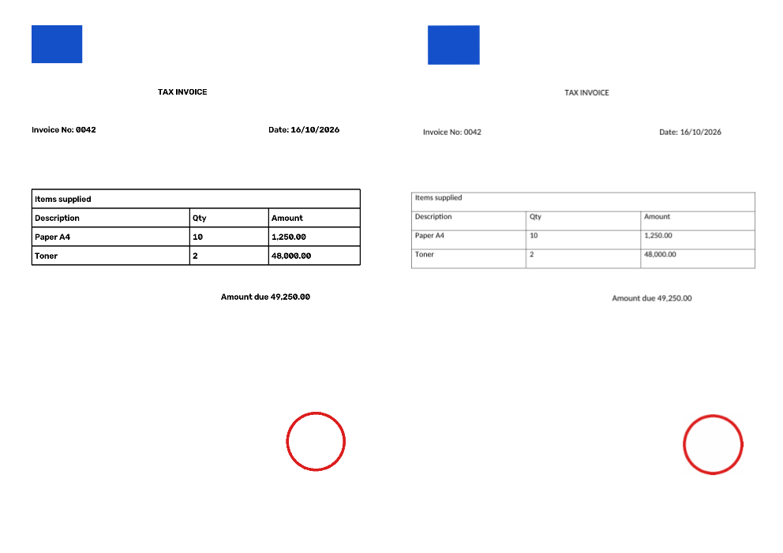

# Mkungi

**From Paper to Perfectly Editable.**

Mkungi is an AI document-reconstruction platform. Ordinary OCR extracts the words; Mkungi rebuilds the whole document — layout, fonts, tables, borders, logos, stamps and signatures — as an editable Word or Excel file that looks like the original.

*Mkungi* evokes a bundle or collection in Chichewa: everything on the page, gathered and put back together.



- **Product brief** — vision, mission, products, customers, ecosystem: [docs/PRODUCT.md](docs/PRODUCT.md)
- **Build plan** — phase-by-phase checklist with gates and quality targets: [docs/BUILD_CHECKLIST.md](docs/BUILD_CHECKLIST.md)
- **Deployment** — Supabase (Postgres + Storage) and Vercel (web + API): [docs/DEPLOYMENT.md](docs/DEPLOYMENT.md)

## How it works

```
upload ─► enhance ─► OCR ─► layout analysis ─► classify ─► write
 PDF/      deskew,    PP-OCR   tables + merged     Mkungi AI    .docx (Word)
 image     denoise    (Rapid-  cells, logos,       picks doc    .xlsx (Excel)
                      OCR)
                               stamps, signatures, type and
                               QR codes, styles    format
```

| Stage | Code |
|---|---|
| Layout model shared by all stages | `backend/app/models.py` |
| Image enhancement, PDF/TIFF pages | `backend/app/pipeline/preprocess.py` |
| OCR engines (RapidOCR, PaddleOCR, Tesseract) | `backend/app/pipeline/ocr.py` |
| Tables, image regions, text style | `backend/app/pipeline/layout.py` |
| Document-type detection | `backend/app/pipeline/classify.py` |
| Word / Excel reconstruction | `backend/app/pipeline/writers/` |
| API | `backend/app/main.py` |
| Job + file storage (local disk or Supabase) | `backend/app/storage.py` |
| Database migration | `supabase/migrations/` |
| Web app | `frontend/` |

Signatures, stamps, QR codes and barcodes are always carried over as images, never re-drawn. Excel output stores amounts as real numbers (`1,250.00` → `1250`, `(300)` → `-300`) so totals can be recalculated.

## Deploy

Production runs on **Supabase** (Postgres for jobs, Storage for files) and **Vercel** (two projects from this repo: `frontend/` as Next.js, `backend/` as a Python function). Step-by-step: [docs/DEPLOYMENT.md](docs/DEPLOYMENT.md).

## Run it locally

```bash
# API: keeps jobs and files on disk unless MKUNGI_SUPABASE_* is set
cd backend
python -m venv .venv && . .venv/bin/activate
pip install -r requirements-dev.txt
uvicorn app.main:app --reload            # http://localhost:8000/docs

# Web app
cd frontend
cp .env.example .env.local
npm install && npm run dev               # http://localhost:3000
```

Or `docker compose up --build`.

OCR defaults to RapidOCR (PaddleOCR's PP-OCR models on ONNX Runtime; small enough for Vercel). On a GPU server, `pip install -r requirements-ocr.txt` and set `MKUNGI_OCR_ENGINE=paddleocr`.

## API

A conversion is three calls, so large files go straight to storage and never through the API. With sign-in on (the default whenever Supabase is configured), add `-H "Authorization: Bearer <supabase session token>"` to each call. Jobs are only visible to the account that created them.

```bash
API=http://localhost:8000

# 1. Create the job → returns id and an upload target {method, url, headers}
curl -s -X POST $API/v1/conversions -H 'Content-Type: application/json' \
     -d '{"filename": "invoice.pdf", "output_format": "auto"}'     # auto | docx | xlsx

# 2. Upload the file to upload.url (a signed Supabase Storage URL in production;
#    a relative /v1/... path on a local API)
curl -X PUT "<upload.url>" -H 'Content-Type: application/pdf' --data-binary @invoice.pdf

# 3. Convert (waits for the result: status, doc_type, pages, tables, images)
curl -s -X POST $API/v1/conversions/<id>/process

curl -s $API/v1/conversions/<id>/download-url  # {"url": 5-minute signed link, "filename": ...}
curl -s $API/v1/conversions                     # your conversions from the last 24 hours
```

## Tests

```bash
cd backend && pytest        # pipeline, real RapidOCR on a sample invoice, API on local + fake Supabase
cd frontend && npm run typecheck && npm run build
```

## Stack

Next.js · React · Tailwind CSS · TypeScript · FastAPI · OpenCV · RapidOCR (PaddleOCR PP-OCR models on ONNX Runtime) · python-docx · openpyxl · pdfium · Supabase (Postgres, Storage) · Vercel. Redis queues, LayoutLMv3/DiT and transformer table detection come in phases 2–3 of the build plan. Word files are written with python-docx, which produces the same Office Open XML as the .NET OpenXML SDK, so the backend stays in one language.
